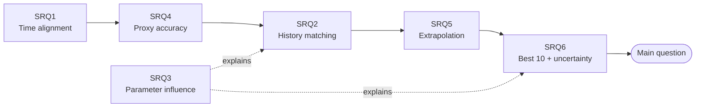

# 01 · Research Questions

**Team SPELUNCA** · ExxonMobil DataWorks Challenge 2026 (DWC26)
**Topic:** *Machine Learning-Assisted History Matching and the Challenge of Production Forecasting*

> [!NOTE]
> **Purpose of this file:** the research questions, the hypothesis behind each one, and how each is tested.
> Results are in [`06_findings_log.md`](06_findings_log.md); methods in [`03_methodology.md`](03_methodology.md).
> Tags: **[Fact]** = confirmed in the starter pack, Kick Off deck or portal · **[Assumption]** = still to confirm.

**Contents**
1. [Main research question](#1-main-research-question)
2. [Alignment with the Kick Off deck](#2-alignment-with-the-kick-off-deck)
3. [Sub-research questions](#3-sub-research-questions)
4. [How the questions connect](#4-how-the-questions-connect)
5. [Hypotheses at a glance](#5-hypotheses-at-a-glance)
6. [Supporting questions](#6-supporting-questions)

---

## 1. Main research question

> [!IMPORTANT]
> **Can a physics-constrained machine-learning proxy, trained on 100 simulated reservoir cases, identify the
> reservoir parameters that are consistent with the field's observed 1998–2008 production history, and use them to
> forecast cumulative oil, gas and water production to 2028 with an honest uncertainty range?**

**Why this question**
- It mirrors the official topic exactly: history matching + production forecasting.
- It is testable with the data provided: 100 cases with simulated curves to 2008, the observed field history, and the
  organisers' split 1–70 / 71–85 / 86–100 [Fact].
- Its output is the required deliverable: 80 quarterly cumulatives, 2008-04-01 → 2028-01-01 [Fact].

---

## 2. Alignment with the Kick Off deck

Kick Off deck, 6 Oct 2026 [Fact].

| Deck objective (slide 26) | Covered by |
|---|---|
| Build a predictive model (proxy) that maps reservoir parameters to production responses | SRQ4 |
| Identify the parameters that minimise the mismatch between simulated and observed data | SRQ2 |
| Generate a history-matched model that reproduces the observed field performance | SRQ2 + SRQ6 |
| Forecast field production over the next 20 years | SRQ5 + SRQ6 |

- **Suggested workflow (slide 30):** data preparation → ML proxy training → ML prediction → optimization (history
  matching) → forecast production.
- **Template meaning (slide 31):** *"Pick the best 10 forecast cases"*. The template's Case 1–10 are our 10 best
  history-matched forecasts, not test cases 86–100.
- **Business framing (slide 30):** the forecast is used to judge whether the field will make money.
- **Stated assumption (slide 30):** rock properties are static (do not change with time).

---

## 3. Sub-research questions

Each question names the pipeline step that answers it (`notebooks/02_pipeline.ipynb`).

### SRQ1: Time alignment
*Step 1: Data preparation*

**How should simulated and observed production be aligned in time?**

| | |
|---|---|
| **Facts** | Observed: 41 quarterly points 1998-01-01 → 2008-01-01. Simulation: 11,096 irregular timestamps, 98.45% blank cells. Case 1's first non-zero rates (15,507.77; 15,275.16) appear one quarter later than the observed ones |
| **Hypothesis** | Observed rates are stamped at the *start* of their quarter; integrating them with that convention removes the offset |
| **Method** | Interpolate cumulatives onto the observed dates; compute the misfit of all cases under the "start" and "end" conventions; cross-check against `RAMP_History` |
| **Success measure** | Clearly lower misfit for the best-matching cases under one convention |
| **Output** | Clean 41-date table for all cases; data-quality log |

### SRQ2: History matching
*Step 3: Optimization (history matching)*

**Which parameter values minimise the mismatch with the observed history, and is the answer unique?**

| | |
|---|---|
| **Facts** | All 100 cases have simulated curves to 2008; the deck asks for an *optimization* step and a crafted loss function |
| **Hypotheses** | (a) A proxy-based optimum fits the history better than any of the 100 simulated cases. (b) Several distinct parameter sets fit almost equally well (non-uniqueness). (c) The accepted set is stable when the assumed observation error changes |
| **Method** | Loss = weighted least-squares misfit with the proxy's uncertainty added (F23); global optimum by differential evolution on the proxy; posterior = best 500 of 20,000 Latin-hypercube samples, weighted w ∝ exp(−O/2) (F24). Baseline: ranking the 100 simulated cases. Sensitivity to σ = 3%, 5%, 10% |
| **Success measure** | Optimum beats the best case; identifiability of each parameter from the posterior spread; stable accepted set across σ |
| **Output** | Ranked case list, accepted set, optimum, posterior, history-match plot |

### SRQ3: Parameter influence
*Step 6: Parameter influence (also explains Steps 3–5)*

**Which of the four uncertainty parameters control production, and does that change between the history and the
forecast?**

| | |
|---|---|
| **Facts** | Fault transmissibility 0.0501–0.1500; porosity multiplier 0.8012–1.4940; permeability multiplier 0.5205–9.7845; aquifer pore volume 53.95–199.84. Case 1 first produces water on 1999-10-01 |
| **Hypotheses** | (a) Permeability and aquifer size drive water-breakthrough timing. (b) Porosity drives long-term oil. (c) Fault transmissibility has the smallest effect |
| **Method** | Spearman correlation over the 100 cases (2008 cumulatives, breakthrough date, misfit, 2028 forecasts); Sobol first-order and total indices on the proxy (2008) and on proxy + forecaster (2028) |
| **Success measure** | A stable importance ranking across oil, gas and water |
| **Output** | Sobol and Spearman tables; breakthrough analysis |

### SRQ4: Proxy accuracy
*Step 2: ML proxy*

**How accurately can an ML proxy reproduce the simulator for unseen cases?**

| | |
|---|---|
| **Facts** | Split: train 1–70, validation 71–85, test 86–100. Grid geometry identical in every case (90,365 cells, 42,512 active) |
| **Hypotheses** | (a) A PCA + Gaussian-process proxy reaches < 5% error on cumulative oil at 2008. (b) Its 80% uncertainty band holds ~80% of held-out values. (c) Grid data add little beyond the four parameters |
| **Method** | One PCA per phase, one Gaussian process per component; baselines = linear regression, gradient boosting on PCA scores, nearest case; model chosen and calibrated on validation; test evaluated once |
| **Success measure** | MAPE, R², RMSE per phase; 80% band coverage |
| **Output** | Validated proxy; accuracy and calibration tables |

> [!TIP]
> Hypothesis (c) was settled by direct inspection rather than by fitting: every case's grid is the base grid × its
> porosity, permeability and aquifer multipliers, and the fault multiplier is absent from the files
> ([`02_data_facts.md` §6](02_data_facts.md#6-grid-workbooks-0308)).

### SRQ5: Extrapolation
*Step 4: Forecast*

**Can we forecast reliably 20 years beyond the data, and which method does it best?**

| | |
|---|---|
| **Facts** | No simulated or observed data after 2008-01-01. Gas/oil = 0.3632–0.3633 MSCF/STB in every case; gas saturation = 0 in every active cell |
| **Hypotheses** | (a) Oil follows a hyperbolic Arps decline with 0 ≤ b ≤ 1. (b) Water follows a ln(WOR)–cumulative-oil trend. (c) Gas = Rs × oil. (d) A physics-based decline is the most reliable extrapolator |
| **Method** | Decline method (Arps + WOR trend + Rs) vs an autoregressive ML forecaster vs a naive benchmark. Temporal backtest: fit on data up to 2004 (window from 2001), forecast 2004 → 2008, compare with the simulator. Water trend and method chosen on validation cases; test reported |
| **Success measure** | Backtest error of the 2004 → 2008 increment; cumulatives never decrease; gas ratio holds |
| **Output** | Selected method; forecasts of all 100 cases to 2028 |

### SRQ6: Best 10 forecasts and uncertainty
*Step 5: Best 10 + Deliverable*

**Which 10 history-matched realisations best represent the field, and how much forecast uncertainty remains?**

| | |
|---|---|
| **Hypotheses** | (a) Matching narrows the P10–P90 range compared with all 100 cases. (b) A meaningful range remains (non-uniqueness). (c) The posterior band holds ~80% of observed values in a backtest |
| **Method** | 10 lowest-misfit parameter sets at least 0.05 apart in scaled space → forecast each from the observed 2008 cumulatives; weighted P90/P50/P10; before-vs-after spread; whole-pipeline backtest against the real field (match ≤ 2004, forecast 2004 → 2008) |
| **Success measure** | Narrower band after matching; P50 backtest error; band coverage |
| **Output** | Filled template (Case 1…10), fan chart, business table (remaining oil, 2028 rates, water cut, oil per pore volume) |

---

## 4. How the questions connect

| Step | Sub-question | Answers | Feeds deliverable |
|---|---|---|---|
| 1. Data preparation | SRQ1 | Is the data comparable? | Source code |
| 2. ML proxy | SRQ4 | Can ML stand in for the simulator? | Source code, Power BI |
| 3. History matching | SRQ2 | Which scenarios are credible? | Slides, Power BI |
| 4. Forecast | SRQ5 | What happens to 2028, and how do we know the method works? | Power BI |
| 5. Best 10 | SRQ6 | Which 10 forecasts, and how sure are we? | Template, slides, video |
| 6. Parameter influence | SRQ3 | Why? Which parameters drive the results? | Slides, report |

Aligned data (SRQ1) → a proxy that generalises (SRQ4) → credible scenarios (SRQ2) → carried forward reliably (SRQ5)
→ reported with uncertainty (SRQ6), explained by the parameters (SRQ3) = the answer to the main question.

---

## 5. Hypotheses at a glance

Verdicts from the run on the real data (details and numbers in [`06_findings_log.md`](06_findings_log.md)).

| SRQ | Hypothesis | Verdict |
|---|---|---|
| SRQ1 | Observed rates are stamped at the start of their quarter | ✅ Supported |
| SRQ2 | (a) Proxy optimum beats every simulated case | ✅ Supported |
| | (b) Non-uniqueness | ✅ Supported |
| | (c) Accepted set stable to the error assumption | ✅ Supported |
| SRQ3 | (a) Permeability and aquifer drive breakthrough timing | ❌ Not supported: porosity does |
| | (b) Porosity drives long-term oil | ✅ Supported |
| | (c) Fault transmissibility has the smallest effect | ✅ Supported |
| SRQ4 | (a) Proxy error < 5% on 2008 oil | ✅ Supported |
| | (b) 80% band holds ~80% | ✅ Supported |
| | (c) Grids add little beyond the parameters | ✅ Supported: they add nothing |
| SRQ5 | (a) Arps decline with 0 ≤ b ≤ 1 | ⚠️ Partly: all fits sit at b ≈ 1 |
| | (b) ln(WOR) vs cumulative oil | ✅ Supported |
| | (c) Gas = Rs × oil | ✅ Supported |
| | (d) Physics-based decline extrapolates best | ❌ Not supported: the ML forecaster wins |
| SRQ6 | (a) Matching narrows the range | ✅ Supported |
| | (b) A meaningful range remains | ⚠️ Partly: the parameter range is small; the choice of method matters more |
| | (c) Band holds ~80% in the backtest | ❌ Not supported: the band leaves out method error |

---

## 6. Supporting questions

| ID | Question | Status |
|---|---|---|
| RQ7 | Is all produced gas solution gas? | **Answered: yes.** The gas–oil ratio is constant in every case and in the observed data |
| RQ8 | What controls water-breakthrough timing? | **Answered: porosity** (Spearman ρ = +0.854), not permeability or aquifer size |
| RQ10 | Is one simulated case effectively the "truth" behind the observed data? | **Answered: no.** The best case (CASE 40) still has a misfit of 0.062 (~0.7% average error), and the proxy optimum fits better |
