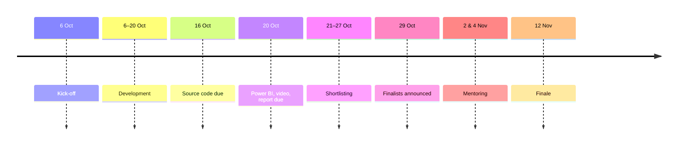

# 02 · Data Facts

> [!NOTE]
> **Purpose of this file:** everything known about the competition and its data, read directly from the DWC26
> starter pack, the Kick Off deck, the portal (14 Oct 2026), our own checks on the real files, and the printed outputs
> of an external notebook we studied for understanding only (no code reused).
> Tags: **[Fact]** = confirmed · **[Assumption]** = still to confirm.

> [!WARNING]
> This file contains values read from competition data. Keep the repository **private** — the DWC26 rules forbid
> publishing the data externally.

**Contents**
1. [Challenge logistics](#1-challenge-logistics)
2. [Kick Off deck: the use case](#2-kick-off-deck-the-use-case)
3. [Files in the starter pack](#3-files-in-the-starter-pack)
4. [01 Introduction.xlsx](#4-01-introductionxlsx)
5. [02 Field Production.xlsx](#5-02-field-productionxlsx)
6. [Grid workbooks 03–08](#6-grid-workbooks-0308)
7. [09 Template Deliverable.xlsx](#7-09-template-deliverablexlsx)
8. [Key derived facts](#8-key-derived-facts)
9. [Open questions](#9-open-questions)

---

## 1. Challenge logistics

[Fact]

| Deliverable | Format and limit | Due (3:00 PM MYT) | Rules |
|---|---|---|---|
| Source code | `.zip` ≤ 100 MB, named `{team_name}.zip` → `SPELUNCA.zip` | **Fri 16 Oct 2026** | Code, ML models, files used for development, analytics and testing |
| Power BI | `.pbix` ≤ 50 MB | **Tue 20 Oct 2026** | Source = our filled `09 Template Deliverable.xlsx`; Power BI 2.154.1260.0 (64-bit, May 2026) or earlier |
| Video | Link in a Notepad `.txt` ≤ 1 MB | **Tue 20 Oct 2026** | 7 min, YouTube public/unlisted; never upload the `.mp4` |
| Report | `.ppt/.pptx` ≤ 16 MB | **Tue 20 Oct 2026** | Executive overview, background, objectives, method, findings, conclusions |

Submission slots lock at the deadline. Data must not be published externally.

---

## 2. Kick Off deck: the use case

[Fact] Kick Off deck, 6 Oct 2026.

| Slide | Content |
|---|---|
| 25 · Problem | History matching aligns simulations with historical production; it is time-consuming and computationally expensive. The dataset is synthetic: reservoir realisations with varying subsurface parameters, their simulated production (oil rate, water rate, **pressure**), and observed production representing the "true" field behaviour |
| 26 · Objectives | Proxy mapping parameters → production; parameters minimising the mismatch; a history-matched model; **forecast the next 20 years** |
| 27 · Scene setting | "High-fidelity physics model reduction"; design an architecture (RNN, autoencoder, DMD suggested), craft a loss function, employ optimization |
| 28 · Dataset | 70 train, 15 validation, 15 test cases; 10 years of production data |
| 29 · Dataset analysis | Higher permeability changes the oil-curve shape; larger aquifer / porosity → more water; zero fault transmissibility → less oil; subsurface uncertainty gives a wide forecast range (the organisers' simulations run to 2030; the provided curves stop at 2008) |
| 30 · Workflow | Data preparation → ML proxy training → ML prediction → optimization (history matching) → forecast production. Goal: judge whether the field will make money. Rock properties are static |
| 31 · Results | Provided curves end ~2008; "optimized curves" continue beyond with a question mark; **"Pick the best 10 forecast cases"** for the template |
| 32 · References | GNN-LSTM proxy (Huang et al., SPE 2023); Bayesian inversion + LSTM proxy (Zhang et al., SPE 2023) |
| 35 · Evaluation | All 4 deliverables on time; accuracy of model output (results and code review); submission quality — business understanding, technical understanding, communication & storytelling; bonus for insights, innovation, collaboration |
| 20 · Finale | Top 5 teams are finalists; finale on 12 Nov at Menara ExxonMobil, KLCC |

> [!IMPORTANT]
> Slide 25 mentions simulated **pressure**, but no pressure data is provided in the files (§5). History matching
> therefore uses production volumes only.

---

## 3. Files in the starter pack

[Fact] `dwc26.zip`: 1,469,202,879 bytes, modified 11 Oct 2026.

| File | Uncompressed size | Contents | Used by the pipeline |
|---|---|---|---|
| README.md | 2,247 B | Topic, file list, submission rules | — |
| DataWorks 2026 - Kick Off.pptx | 54,352,380 B | Kick Off deck (§2) | — (read for §2) |
| 01 Introduction.xlsx | 27,439 B | Nomenclature; Uncertainty Values | **Yes** |
| 02 Field Production.xlsx | 15,570,403 B | Observed history + 6 simulation-curve sheets | **Yes** |
| 03 Train Cases 1.xlsx | 331,199,004 B | Grid, Cases 1–20 | Check only (`01_eda` §9) |
| 04 Train Cases 2.xlsx | 331,269,366 B | Grid, Cases 21–40 | Check only |
| 05 Train Cases 3.xlsx | 331,238,475 B | Grid, Cases 41–60 | Check only |
| 06 Train Cases 4.xlsx | 165,657,170 B | Grid, Cases 61–70 | Check only |
| 07&nbsp;&nbsp;Validation Cases.xlsx | 248,405,728 B | Grid, Cases 71–85 (**two spaces** in the file name) | Check only |
| 08 Test Cases.xlsx | 248,423,433 B | Grid, Cases 86–100 | Check only |
| 09 Template Deliverable.xlsx | 31,717 B | Forecast template to fill | **Yes** (output) |

---

## 4. `01 Introduction.xlsx`

[Fact]

### Uncertainty Values: 100 cases × 4 parameters

Case column = `Item`.

| Parameter | Min | Max | Mean | Physical meaning |
|---|---|---|---|---|
| Fault Transmissibility | 0.0501 | 0.1500 | 0.0996 | Multiplier on flow across faults (< 0.15 → mostly sealing) |
| Porosity Multiplier | 0.8012 | 1.4940 | 1.1485 | Scales pore volume → oil in place |
| Permeability Multiplier | 0.5205 | 9.7845 | 5.1998 | Scales permeability → flow capacity (~19× range) |
| Aquifer Pore Volume | 53.95 | 199.84 | 125.17 | Aquifer size → pressure support, water influx |

- The inputs were varied independently: the largest Spearman correlation between two parameters is 0.17.
- A few cases sit slightly outside the training range (cases 1–70): validation fault transmissibility by 0.7% and
  permeability by 3.2% of the training range; test permeability by 1.7%.
- [Assumption] Values look uniformly random within bounds (design of experiments, e.g. Latin hypercube).

<b>Nomenclature sheet</b> (click to expand)

- **Grid:** I, J, K index; X, Y, Z coordinate.
- **Static (21):** PORV, PORO, PERMX, PERMY, PERMZ, NTG, TRANX, TRANY, TRANZ, PVTNUM, SWL, SWLPC, SWCR, SWU, SGL, SGLPC,
  SGCR, SOWCR, SOGCR, PCW, PCG.
- **Dynamic (6):** PRESSURE, SWAT, SOIL, SGAS, RS, RV.
- **Errors in the sheet:** the descriptions for SGCR, SOWCR, SOGCR, PCW, PCG (rows 23–27) are shifted one row; SWCR is
  mislabelled "Sgcr" (it is the critical water saturation).

---

## 5. `02 Field Production.xlsx`

[Fact] 8 sheets: `Plots`, `Field Production`, and a cumulative and a rate sheet each for gas, oil and water.
**No pressure sheet.**

### Sheet `Field Production`: the observed history

- 41 rows, quarterly, 1998-01-01 → 2008-01-01, no blanks.
- Intervals: 92 days × 20, 91 × 12, 90 × 8 (calendar quarters, including leap years 2000 and 2004).
- Columns: Identifier ("Field"), Date, Oil production rate (STB/d), Gas production rate (MSCF/d), Water production
  rate (STB/d), Water injection rate (STB/d).
- First three quarters = 0. Production and injection start on **1998-10-01**: oil 15,507.77 · gas 5,633.97 ·
  water 0 · injection 14,748.87. On 1999-01-01: oil 15,275.16 · gas 5,549.46 · water 0 · injection 12,098.46.

| Observed behaviour | Value |
|---|---|
| Peak oil rate | 15,508 STB/d (1998-10-01) |
| Plateau | Within 5% of peak until it first drops below on 2002-01-01 |
| Oil rate at 2008-01-01 | 5,067 STB/d — 67.3% below peak |
| First water | 1999-04-01 |
| Water rate exceeds oil rate | From 2006-04-01 |
| Water cut at 2008-01-01 | 61.0% |
| Injection | 14,749 STB/d at start → 9,327 STB/d at the end of history |
| Gas–oil ratio | 0.3630–0.3636 MSCF/STB (constant) |

[Assumption] Injection from day one → a waterflood with pressure maintenance.

### Six simulation-curve sheets

- Gas / Oil / Water production cumulative; Gas / Oil / Water production rate.
- Header rows: (0) `Y1…Y101` · (1) `Case_1…Case_100` + `RAMP_History` · (2) units.
- 11,096 irregular timestamps 1998-01-01 → 2008-01-01; **98.45%** blank cells (each case reports about 170 of them).
- 102 columns = Date + 100 cases + `RAMP_History`. `RAMP_History` is **the observed history**, not a case (§9).
- **One-quarter offset:** Case 1's oil 15,507.77 sits at 1999-01-01 vs observed 1998-10-01; 15,275.16 is shifted the
  same way. Resolved by the "start" convention (§9).
- All 100 cases produce identical volumes until 1999-04-01 (the wells deliver a set rate); the cases separate later.
- Late values (oil rate, STB/d): 2007-10-01 Case 1 = 4,770.26, Case 2 = 5,735.12, Case 3 = 3,534.59;
  2008-01-01 Case 1 = 4,636.76. Case 1 first water: 1999-10-01, 82.98 STB/d.

---

## 6. Grid workbooks 03–08

[Fact] One sheet per case, named `Case 1` … `Case 100`. Checked on the real files (`01_eda.ipynb` §9, `src/grid.py`).

> [!IMPORTANT]
> **Conclusion.** Every grid checked is the **same base grid with the same initial state**, changed only by the
> porosity, permeability and aquifer multipliers; the **fault multiplier is not in the files at all**. The grids hold
> no information beyond the 4 parameters, so they are not model inputs. From the 4 parameters alone the proxy
> reproduces the simulator to 0.04% (oil) and 0.09% (water) on test cases — an upper bound on what any grid feature
> could add.

### Structure

- **90,365 cells per case, 42,512 active (47.0%)** — the same cells and the same active set in every case.
- **29 columns**, header = description + code in brackets: I, J, K index · X, Y, Z coordinate · PORV, PORO, PERMX,
  PERMY, PERMZ, NTG, TRANX, TRANY, TRANZ, FIPNUM, PVTNUM, SWL, SWCR, SWU, SGL, SGCR, SOWCR · PRESSURE, SWAT, SOIL,
  SGAS, RS, RV.
- The SGL header is misspelt `" Connateg  Gas Saturation (SGL)"`; the code reads the code in brackets, so this is
  harmless.
- Listed in the `01 Introduction` nomenclature but **not present**: SWLPC, SGLPC, SOGCR, PCW, PCG.
- Inactive cells: PORV = 0 and −999.25 in the other property columns.
- SWL (connate water) 0.20–0.27; FIPNUM and PVTNUM ∈ {1, 2}.
- PRESSURE, SWAT, SOIL, SGAS, RS, RV are identical in every case → the snapshot is the **initial state** (an
  end-of-history snapshot would differ between cases).

| Active-cell property | Train | Validation | Test |
|---|---|---|---|
| Porosity | 0.0288–0.2749 | 0.0301–0.2709 | 0.0292–0.2722 |
| Water saturation | 0.20–1.00 | 0.20–1.00 | 0.20–1.00 |
| Oil saturation | 0.00–0.80 | 0.00–0.80 | 0.00–0.80 |
| Gas saturation | 0 | 0 | 0 |
| Region IDs (FIP, PVT) | {1, 2} | {1, 2} | {1, 2} |

### How cases differ

Verified cell by cell on **35 cases** (15 Oct 2026): Cases 1–20 (file 03, train) and 86–100 (file 08, test). Every
column of every active cell was predicted as Case 1 × the multiplier ratios from `01 Introduction`
(`src/grid.check_case`).

| Multiplier | What changes in the grid | Cells | Largest error over 35 cases |
|---|---|---|---|
| Porosity | PORO and PORV of every active cell | 42,512 | PORO 2.7e-5, PORV 2.5e-7 (export rounding) |
| Permeability | PERMX, PERMY and, through them, TRANX, TRANY in one region; PERMZ and TRANZ unchanged | 11,575 | 4.2e-6; 100% of TRANX/TRANY cells between 1 and the permeability ratio |
| Aquifer pore volume | PORV of the aquifer cells (on top of the porosity scaling) | 2,286 | Included in PORV above |
| Fault transmissibility | **Not present in any column.** In the 19 cases where the fault ratio cannot be confused with a permeability boundary value, 0 cells change by it — the simulator applies it on fault faces, which are not exported | — | — |
| — | The other 23 columns (I/J/K, X/Y/Z, PERMZ, NTG, TRANZ, FIPNUM, PVTNUM, SWL, SWCR, SWU, SGL, SGCR, SOWCR, PRESSURE, SWAT, SOIL, SGAS, RS, RV) | All | Identical (difference 0) |

> [!NOTE]
> Files 04–07 (cases 21–85, including all validation cases) are not checked here. Run `01_eda.ipynb` §9 with
> `GRID_SCOPE = "all"` on a machine that has them to confirm 100 of 100.

### Reservoir layout

From the base grid.

| Group | Cells | Pore-volume share | Location |
|---|---|---|---|
| Oil zone (SOIL > 0) | 11,004 | 4.2% | I 4–43, J 5–53, all layers; Z −7,572 to −8,100 |
| Aquifer cells | 2,286 | 83.5% | Grid edge, I 51–53, J 1–55; Z −8,311 to −9,153 (below the oil); none in the oil zone; very large cells |
| Permeability region | 11,575 | 2.8% | Lower layers K 13–31; 3,759 cells in the oil zone, 7,816 below it |

Z values as exported (likely ft, negative downward). The aquifer is far from and below the oil, so its support arrives
late; the permeability multiplier acts mostly in water-bearing layers. Both are consistent with the Sobol results:
aquifer and permeability matter more for 2028 water than for 1998–2008 production.

### Initial hydrocarbon pore volume (HCPV)

- HCPV = Σ PORV × SOIL over active cells (F3a). Case 1 = 140,074,270 rb at porosity multiplier 1.0823 →
  **129,421,914.67 rb at multiplier 1.0**. HCPV of any case = this × its porosity multiplier (holds to 2e-9 in all 35
  cases; stored in `config.yaml → grid.hcpv_base_rb`).
- The oil formation volume factor (Bo) is not provided, so stock-tank oil in place N = HCPV / Bo cannot be computed
  exactly. The business table reports N_p / HCPV [STB/rb] instead (= recovery factor ÷ Bo).

---

## 7. `09 Template Deliverable.xlsx`

[Fact]

- 10 sheets: Case 1 … Case 10 (= our 10 best forecasts, Case 1 = best match).
- Columns: Date · Gas production cumulative [MSCF] · Oil production cumulative [STB] · Water production cumulative [STB].
- 80 quarterly rows, 04/01/2008 → 01/01/2028 (MM/DD/YYYY). Dates are **text** except the last row (a real date).
- Sheets Case 1–3 extend to column E (empty); the others end at D.

---

## 8. Key derived facts

- **Constant gas–oil ratio:** 5,633.97 / 15,507.77 = 0.3633 and 5,549.46 / 15,275.16 = 0.3633 MSCF/STB
  (≈ 363 scf/STB). Verified everywhere: 0.3632–0.3633 in all 100 cases over 1998–2008, 0.3630–0.3636 in the observed
  data. With Sg = 0, produced gas is solution gas.
- **README wording error:** `08 Test Cases` is described as "used to train model robustness" (likely a copy-paste).

---

## 9. Open questions

| # | Question | Status |
|---|---|---|
| 1 | Template Case 1–10 mapping | ✅ Resolved by slide 31: our best 10 forecasts |
| 2 | Exact accuracy metric used for judging | ⏳ **Open** — slide 35 says "accuracy of model output", without a formula |
| 3 | Any simulation data after 2008? | ✅ Resolved: no (curves end 2008-01-01) |
| 4 | Date of the grid snapshot | ✅ Resolved: initial state (identical in every case, §6) |
| 5 | Full list of grid columns | ✅ Resolved: 29 columns (§6) |
| 6 | What `RAMP_History` is | ✅ Resolved: the observed history (difference ≤ 3e-8) |
| 7 | One-quarter offset | ✅ Resolved: "start" convention (rate stamped at the start of its quarter) |
| 8 | Pressure sheet in `02`? | ✅ Resolved: no (8 sheets: Plots, Field Production, 3 cumulative + 3 rate) |
| 9 | Do grids add information beyond the parameters? | ✅ Resolved: no (35 of 100 cases checked; files 04–07 pending) |
