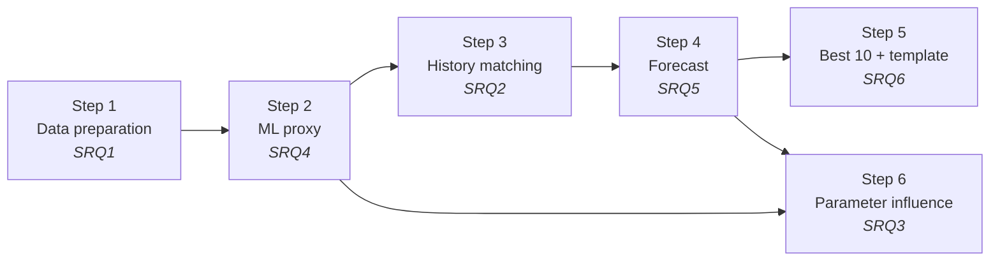
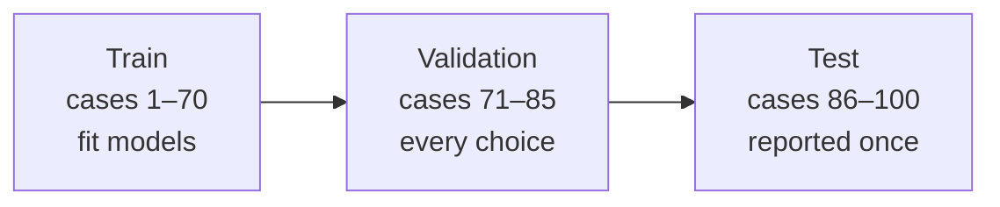

# 03 · Methodology

> [!NOTE]
> **Purpose of this file:** how we answer each research question: the research design, data, preparation, methods,
> metrics, assumptions and limitations. Formulas (F#) are in [`04_formulas.md`](04_formulas.md); references [R#] in
> [`05_references.md`](05_references.md); results in [`06_findings_log.md`](06_findings_log.md).

**Contents**
1. [Research design](#1-research-design)
2. [Data](#2-data)
3. [Data preparation (SRQ1)](#3-data-preparation-srq1)
4. [Methods by sub-question](#4-methods-by-sub-question)
5. [Evaluation metrics](#5-evaluation-metrics)
6. [Assumptions](#6-assumptions)
7. [Limitations](#7-limitations)
8. [Reproducibility and ethics](#8-reproducibility-and-ethics)
9. [Methodology at a glance](#9-methodology-at-a-glance)
10. [Code map](#10-code-map)

---

## 1. Research design

| Element | Choice | Justification |
|---|---|---|
| Research type | Quantitative, computational, simulation-based | All evidence is numerical simulator output and observed field data |
| Approach | Deductive: hypotheses tested against data | Each SRQ has a stated hypothesis and a measurable test |
| Strategy | Surrogate-assisted inverse modelling (history matching) + physics-constrained forecasting | Standard framework in reservoir engineering [R1][R24][R25] |
| Unit of analysis | One simulation case (one combination of 4 parameters) | 100 cases |
| Time horizon | History 1998-01-01 → 2008-01-01 (41 quarters); forecast 2008-04-01 → 2028-01-01 (80 quarters) | Set by the data and the template |
| Philosophy | Positivist: claims are tested against data, and uncertainty is reported rather than a single "true" answer | Non-uniqueness of history matching [R1] |

---

## 2. Data

### 2.1 Sources

| # | Source | Content | Role |
|---|---|---|---|
| 1 | `02 Field Production` → `Field Production` | Observed field rates, 41 quarters | Target of matching; start of the forecast |
| 2 | `02 Field Production` → 3 cumulative sheets | Simulated curves, Cases 1–100 + `RAMP_History`, 11,096 timestamps | Proxy training data |
| 3 | `01 Introduction` → `Uncertainty Values` | 100 cases × 4 parameters | Proxy inputs |
| 4 | Files 03–08 | Grid properties: 90,365 cells/case, 42,512 active, 29 columns | **Checked, not model inputs.** Every case is the base grid × its multipliers (§4, SRQ4); used for HCPV (F3a) and the reservoir layout |
| 5 | `09 Template Deliverable` | 10 cases × 80 quarters × 3 cumulatives | Output specification |

### 2.2 Variables

| Role | Variable | Unit |
|---|---|---|
| Independent | Fault transmissibility (x₁), porosity multiplier (x₂), permeability multiplier (x₃, as ln), aquifer pore volume (x₄) | Dimensionless / as given |
| Dependent | Cumulative oil, gas, water production vs time | STB, MSCF, STB |
| Derived | Rates, water cut, WOR, GOR, breakthrough date, misfit Oⱼ | STB/d, fraction, MSCF/STB, date, none |
| Controlled | Grid geometry; well and injection schedule to 2008 | Not applicable |
| Derived from grid | HCPV = 129,421,914.67 rb × porosity multiplier (F3a). Other grid aggregates are exact functions of x₂–x₄, so not used as covariates | rb |

### 2.3 Sample and partitioning

- Population: 100 simulated cases. Split (organisers): train 1–70 (70%), validation 71–85 (15%), test 86–100 (15%).
- Split **by case**, never by row or date within a case (prevents leakage across cases that share one grid).
- Temporal holdout (SRQ5): fit on data up to 2004-01-01 (fit window from 2001-01-01), test window 2004 → 2008.
- After every choice is made, the final proxy and forecasters are refitted on all 100 cases; reported validation and
  test scores always come from models fitted on the training cases only.

---

## 3. Data preparation (SRQ1)

1. **Extract**: map header row 1 to case IDs; separate `RAMP_History` from the cases.
2. **Clean**: cumulatives never decrease and are never negative (`qc_report.csv`). Grid files need no cleaning for the
   pipeline because they are not model inputs; `01_eda.ipynb` §9 reads them with −999.25 → missing and inactive cells
   (PORV = 0) excluded.
3. **Align**: interpolate each case's **cumulatives** linearly in time onto the 41 observed dates (F20). Average rates
   are derived from cumulative differences (F21) in the forecast step.
4. **Date-convention test**: misfit of all cases under the "start" and "end" conventions (F22); choose the lower
   median misfit of the 10 best cases; report both, with `RAMP_History` as a cross-check.
5. **Observed cumulatives**: integrate observed rates with real day counts (F14).
6. **QC**: cumulatives non-decreasing; values ≥ 0; gas–oil ratio within 2% of 0.3633 (F13).
7. **Features**: min–max scale x₁…x₄ (F28) with x₃ = ln(permeability multiplier).

Output: analysis-ready table + data-quality log (the log is itself a finding).

---

## 4. Methods by sub-question

In the order of the deck's workflow (slide 30).

### SRQ4: ML proxy
*Deck: "ML proxy model training / prediction"*

- **Model:** one PCA per phase on the oil, gas and water cumulative curves (a linear autoencoder; components to
  ≥ 99.999% variance, at least 3 per phase), one Gaussian process per component (F29, F30) [R24][R25].
- **Why a tight variance target:** ~99.96% of history variance is one mode (porosity); a loose target would discard
  the smaller permeability, aquifer and fault effects.
- **Kernel:** Matérn 5/2 with one length scale per input, maximum marginal likelihood.
- **Physics:** predictions forced non-negative and non-decreasing (F46).
- **Uncertainty:** GP variance + PCA truncation error, **calibrated on validation cases** so the 80% band holds ~80%
  of held-out points (F47); checked once on test.
- **Baselines:** linear regression, gradient boosting on PCA scores, nearest case.
- **Protocol:** fit 1–70 → compare and calibrate on 71–85 → report 86–100 **once** → refit on all 100 for matching,
  keeping the validated calibration.

> [!TIP]
> **Grid-feature experiment: settled without fitting.** The grid check (`01_eda.ipynb` §9) rebuilds every case cell
> by cell as the base grid × its multipliers (PORO/PORV × porosity; PERMX/Y and TRANX/Y × permeability in 11,575
> cells; aquifer PORV in 2,286 cells; 23 columns identical; verified on 35 cases) and finds the fault multiplier absent
> from the files. Grid aggregates are therefore exact functions of x₂–x₄ and cannot improve the proxy; the proxy's test
> error from the 4 parameters alone (0.04% oil) bounds what they could add. The grids are used instead to locate the
> oil zone, aquifer and permeability region, which explains the sensitivity results (SRQ3).

### SRQ2: History matching
*Deck: "Optimization (History Matching)"*

- **Loss** (deck: "craft a loss function"): weighted least-squares misfit (F23) with the proxy's own uncertainty
  added to the error variance, so the optimiser does not over-trust the proxy.
- **Global optimum:** differential evolution on the proxy (seeded, polished).
- **Posterior:** 20,000 Latin-hypercube samples scored with the proxy; the best 500 kept and weighted
  w ∝ exp(−O/2) (F24) [R23].
- **Baseline:** rank the 100 simulated cases directly; σ sensitivity (3%, 5%, 10%).

### SRQ5: Forecasting beyond 2008
*Deck: "Forecast production"*

| Method | Oil | Water | Gas |
|---|---|---|---|
| Decline (physics-based) | Hyperbolic Arps on the 2004–2008 history (F16), 0 ≤ b ≤ 1, restarted at the last actual rate with the decline rate reached by then (F16a, F17) [R13] | Two WOR trends (ln(WOR) vs cumulative oil (F18) and vs time), anchored to the last WOR, slope ≥ 0, WOR capped at 100 [R26] | Solution gas, Rs = ΔGp/ΔNp over the fit window (F13) |
| ML autoregressive | Gradient-boosted next-quarter ratio ln(q_o,k+1/q_o,k), given the parameters and the current state (F48), in the spirit of the deck's RNN suggestion [R28][R29] | Same model, Δln(1+WOR) | Rs × oil |
| Naive benchmark | Last rate held constant | Last rate held constant | Last rate held constant |

- Cumulatives accumulated quarterly with real day counts (F15) → always non-decreasing.
- **Case backtest:** fit on data up to 2004, forecast 2004 → 2008, compare with the simulator (validation and test
  cases); error = increment error (F50).
- **Selection (validation only):** the water trend by water error; the method (decline or ML) by the mean oil + water
  error. The other method is kept to report **model-form uncertainty**.

### SRQ6: Best 10 forecasts and uncertainty
*Deck slide 31: "Pick the best 10 forecast cases"*

- 10 parameter sets with the lowest misfit, at least 0.05 apart in scaled parameter space (F49), so they are
  genuinely different realisations rather than near-copies.
- Each: proxy history → shifted to end on the observed 2008 cumulatives → forecast to 2028 → template sheets
  Case 1…10 (best first).
- Weighted P90 / P50 / P10 across the posterior (F45); spread compared with all 100 unmatched cases.
- **Whole-pipeline backtest vs the observed field:** match on observed data up to 2004 only, pick the best 10, forecast
  2004 → 2008, measure P50 error and posterior-band coverage.
- **Business table** (deck: "will the field make money"): remaining oil 2008–2028, 2028 rates, water cut (F40),
  WOR-cap flag, HCPV and N_p(2028) / HCPV (F3a, F42; Bo is not provided, so the recovery factor itself is not stated).

### SRQ3: Parameter influence

- Spearman correlation (100 cases): each parameter vs 2008 cumulatives, breakthrough date, misfit and 2028 cumulatives.
- Sobol first-order and total indices (F31, F32) on the proxy (2008) and on proxy + chosen forecaster (2028) [R15].
- Interpretation supported by the reservoir layout from the grid files (`02_data_facts.md` §6).

---

## 5. Evaluation metrics

| Metric | Formula | Used for |
|---|---|---|
| RMSE | F33 | Proxy, whole curve |
| MAPE (excluding y ≈ 0) | F35 | Proxy, 2008 cumulative |
| R² | F36 | Proxy, 2008 cumulative |
| End-point relative error | F37 | Proxy at 2008; 2004 → 2008 backtests at 2008 |
| P10–P90 coverage | F38 | Proxy band; posterior band in the field backtest |
| Increment error | F50 | Choosing the water trend and the forecasting method |
| Misfit Oⱼ | F23 | History matching |

Reported **per phase** (oil, gas, water) and **per split** (validation, test, backtest).

> [!IMPORTANT]
> No metric exists for 2028 itself: there is no truth after 2008. Forecast accuracy is estimated by the backtests.

---

## 6. Assumptions

| # | Assumption | Status |
|---|---|---|
| 1 | The 100 cases span the plausible parameter range (bounds from the organisers) | Accepted; the observed field lies inside the simulated range |
| 2 | Observation errors are independent Gaussian, σ = 5% (sensitivity 3%, 10%) | Assumed; accepted set unchanged at 3% and 10% |
| 3 | Post-2008 well and injection operations continue as at the end of history | Assumed |
| 4 | Pressure stays above the bubble point → constant gas–oil ratio | ✅ Verified on all cases and the observed data |
| 5 | Grid = base model scaled by the multipliers | ✅ Confirmed on the real files (35 cases) |
| 6 | Rock properties are static over time | Stated by the organisers (slide 30) |
| 7 | The decline and WOR trends seen in 2004–2008 continue after 2008 (no new wells or workovers) | Assumed |

---

## 7. Limitations

1. No truth after 2008 → forecast accuracy is estimated only via backtests, which cover 4 years for a 20-year forecast.
2. Small sample (70 training cases) limits model complexity.
3. Non-uniqueness → the answer is a range, not a point.
4. Simplified physics in the decline and ratio methods (e.g. ignores changes in well count).
5. Water is the least certain phase: the whole-pipeline backtest gives 5.7% P50 error for water against 0.8% for oil.
6. The P10–P90 band covers parameter uncertainty only; model-form uncertainty is reported separately.
7. The proxy has seen simulated curves after 2004 for the training cases; the whole-pipeline backtest withholds only
   the *observed* field data after 2004, not the simulator's.
8. No pressure data → parameters that act mainly through pressure support are weakly constrained.

---

## 8. Reproducibility and ethics

- **Tools:** Python ≥ 3.12 (pandas, NumPy, SciPy, scikit-learn, SALib, openpyxl); Power BI ≤ 2.154.1260.0.
- **Determinism:** fixed random seeds; pinned versions (`requirements.txt`); one module per step; the whole method
  reruns from `notebooks/02_pipeline.ipynb`.
- **Tests:** unit tests for every formula plus an end-to-end test on a synthetic dataset with the real file structure;
  run in CI on every push (the real data never enters git or CI).
- **Data:** used only for DWC 2026; not published externally; notebook outputs cleared before committing.
- **External notebook:** reviewed for data understanding only; no code or text reused; acknowledged in the report.

---

## 9. Methodology at a glance

| Step (deck slide 30) | Input | Method | Output | Validation |
|---|---|---|---|---|
| 1. Data preparation (SRQ1) | Raw Excel | Cumulative interpolation, date-convention test, QC | Clean 41-date table | QC, convention comparison, `RAMP_History` |
| 2. ML proxy (SRQ4) | Cases 1–70 | Per-phase PCA + calibrated GP vs 3 baselines | Proxy | Validation 71–85, single test 86–100 |
| 3. History matching (SRQ2) | Proxy + observed | Weighted misfit, differential evolution, weighted LHS posterior | Optimum + posterior | Beats best simulated case; σ sensitivity |
| 4. Forecast (SRQ5) | History curves | Decline (Arps + WOR trend + Rs) vs ML autoregressive vs naive | Selected method; 2028 forecasts | 2004 → 2008 backtest on validation and test |
| 5. Best 10 (SRQ6) | Posterior | Diverse best-10 pick, P90/P50/P10 | Filled template, business table | Whole-pipeline backtest vs the observed field |
| 6. Influence (SRQ3) | Proxy + forecaster | Spearman, Sobol; grid layout | Parameter ranking | Agreement with deck slide 29 |

---

## 10. Code map

Work happens in the notebooks; `src/*.py` files hold functions only.

| File | Job | Sub-question |
|---|---|---|
| `notebooks/01_eda.ipynb` | Exploratory analysis of every input file; grid check | All |
| `notebooks/02_pipeline.ipynb` | Runs the method step by step; answers the research questions | All |
| `notebooks/03_results_figures.ipynb` | Slide figures from the saved tables | Supporting |
| `src/config.py` | Load `config.yaml` + `.env` (`DWC26_DATA_DIR`) | Supporting |
| `src/io_load.py` | Read every input file (searches sub-folders) | Supporting |
| `src/s1_prepare.py` | Data preparation | SRQ1 |
| `src/s2_proxy.py` | ML proxy training + calibrated prediction | SRQ4 |
| `src/s3_history_match.py` | History matching | SRQ2 |
| `src/s4_forecast.py` | Forecasting + backtest + benchmarks | SRQ5 |
| `src/s5_best10.py` | Best 10, uncertainty, business table, pipeline backtest | SRQ6 |
| `src/deliverable.py` | Fill the template (a copy; the original is never edited) | Deliverable |
| `src/s6_sensitivity.py` | Parameter influence | SRQ3 |
| `src/grid.py` | Grid-file checks, HCPV, reservoir layout | SRQ4, SRQ3 |
| `src/metrics.py`, `src/utils.py` | Scoring formulas; scaling, splits, weighted percentiles | Supporting |
| `src/plotting.py`, `src/report.py` | Figure style; generated findings text | Supporting |
| `src/pipeline.py` | Runs all steps in one call (used by the end-to-end test) | Supporting |
